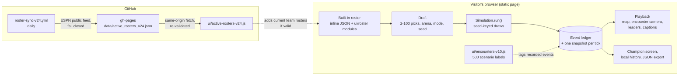

# LAST LEGEND

LAST LEGEND is a free browser game in which athletes, team mascots and other characters fight a storm-driven
survival battle until one is left. You draft 2 to 100 contestants from a built-in library of 1,664
entries, pick an arena and a randomness level, and watch a seeded match play out on a 2D map. Fights, alliances,
supply runs and storm damage are decided by a deterministic simulation, then replayed with commentary, live
leaderboards and a champion screen. The same seed and lineup always produce the same match, so a result can be
replayed, shared as a link and tested. It is a static site with no build step and no server: everything runs in
the visitor's browser. It is for anyone who wants to set up an impossible matchup and see who survives, and for
engineers curious how far a single static page with a seed-keyed simulation can be pushed.

**[Play LAST LEGEND](https://alexrosen23.github.io/LASTLEGEND/)** (GitHub Pages)

> **Fictional game data.** The roster uses real names, but every rating, personality trait, ability and
> encounter is game design, not a claim about a real person. Mascot and character depictions are provisional
> interpretations, not licensed likenesses. The project is not affiliated with any league, team or athlete.

## At a glance

| | |
|---|---|
| **Status** | Working and public. The game (draft, simulation, replay, website pages, local-only extras) is live on GitHub Pages. One feature is currently broken on the live site: the current NBA/NFL/MLB/NHL team rosters fail to load (see [Limitations](#limitations-and-whats-next)). Accounts, global leaderboards and multiplayer are not built. |
| **Stack** | Vanilla JavaScript, HTML, CSS and SVG (one static page plus 29 feature modules); Python 3.12 for the reference engine, roster tooling and browser tests (Playwright); Node 22+ for the feature tests; GitHub Actions and GitHub Pages |
| **Run it** | Open the [live site](https://alexrosen23.github.io/LASTLEGEND/), or `python3 -m http.server 8000` in the repo root and open http://127.0.0.1:8000 |
| **Verified** | 2026-11-09 against `main` at `8b4641c`. The game files on `main` (`index.html`, `identity-lab.html`, `ui/`) are byte-identical to the deployed `gh-pages` branch on that date. |
| **License** | No license file; all rights reserved. |

## Why this exists

### The question

"Who would win if these twelve people were dropped into the same arena?" is a fun question with no real answer.
A game that pretends to answer it has to be careful about three things at once:

- **It has to be a contest, not a lottery and not a ranking.** If outcomes are pure chance, the athletes don't
  matter. If the highest overall rating always wins, every match is decided at the draft. The original design
  spec ([`source_v0_1/01_MASTER_DESIGN.md`](source_v0_1/01_MASTER_DESIGN.md)) puts it as "Strength is not combat
  technique. Elite sprinting isn't marathon endurance." the right abilities should matter in the right
  situations, and upsets should still happen.
- **The story has to match what happened.** A match with dozens of eliminations needs commentary, and commentary
  is where a game invents things: a knockout nobody threw, a betrayal that wasn't recorded, a jersey number that
  person never wore.
- **It uses real names.** That makes honesty about the data part of the design: which facts are sourced, which
  are game estimates, and what to show when a fact is not known.

### Why the obvious approaches fall short

1. **`Math.random()` in a game loop isn't reproducible.** The same lineup gives a different match each time,
   so a result can't be replayed, shared or turned into a regression test, and any change to iteration order
   silently changes outcomes.
2. **A single "overall" rating makes the outcome predictable.** It also lets popularity stand in for ability.
3. **Free-form narration drifts from the state.** If text is written separately from the simulation (by hand, by
   template or by a language model), nothing guarantees that the caption and the scoreboard agree.
4. **Filling unknown facts with plausible guesses looks fine and is wrong.** A guessed jersey number on a real
   athlete is a small, visible falsehood, repeated across a 1,000-entry roster.
5. **Live roster data from a third party can arrive partial.** Publishing whatever came back would make the game
   claim coverage it doesn't have.

### Principles that shape the design

| Principle | Where it lives |
|---|---|
| **Every random draw is keyed, not sequential.** `draw(seed, purpose, tick, actor…)` hashes its inputs, so a draw depends only on what it is for. The roster is sorted before use, so lineup order doesn't matter, and `Math.random` is never used for outcomes. | `draw()` and `Simulation` in the inline script of [`index.html`](index.html); Python twin in [`engine/simulation.py`](engine/simulation.py) |
| **Contests use situation-specific weights.** Eight contest types (sprint escape, pursuit, attack, defence, cache grab, negotiation, hazard, long trek) each weight different ratings. A logistic curve turns the score gap into a win chance, with a temperature set by the Realistic, Balanced or Chaos mode and clamped to 2.5–97.5%, so no outcome is certain. | `WEIGHTS`, `TEMPS`, `logistic()`, `Simulation.contest()` in [`index.html`](index.html) |
| **Simulate first, then present.** `Simulation.run()` computes the whole match, every event and a snapshot per tick, before playback starts. Camera, speed, captions and art only read recorded frames, so presentation can't change a result. | `startMatch()` in [`index.html`](index.html); the V6/V7 PRs state "no simulation changes" ([#1](https://github.com/AlexRosen23/LASTLEGEND/pull/1), [#2](https://github.com/AlexRosen23/LASTLEGEND/pull/2)) |
| **The story is told from the event ledger.** Each event records its tick, participants, positions and details. Encounter scenes and captions are chosen for a recorded event and keep its participants, damage and winner. | `Simulation.emit()`; [`ui/encounters-v10.js`](ui/encounters-v10.js); [`ui/broadcast-v29.js`](ui/broadcast-v29.js) |
| **Unknown means blank.** A jersey number is shown only when it has a recorded source; sports without permanent numbers show none. Appearance styling for unreviewed entries is deterministic cartoon styling, labelled as such. | `test_verified_numbers_only` in [`tests/test_simulation.py`](tests/test_simulation.py); [`data/verified_jersey_v26.json`](data/verified_jersey_v26.json); [docs/RELEASE_V5.md](docs/RELEASE_V5.md) |
| **The match always ends, with no rating tie-break.** A shrinking storm circle pushes survivors together; if more than one is left at the tick limit, seeded final engagements continue until one remains. Alliances are dissolved at three survivors. | `radius()`, `safeRadius()`, `run()` in [`index.html`](index.html) |
| **External data fails closed.** The roster sync refuses a capture with a missing team or a suspicious count, and the browser re-validates the snapshot before using it. If it can't, the game says so and falls back to the built-in library. | [`tools/sync_active_rosters_v24.py`](tools/sync_active_rosters_v24.py), [`ui/active-rosters-v24.js`](ui/active-rosters-v24.js), [docs/ROSTER_V25_COVERAGE_AND_LIMITS.md](docs/ROSTER_V25_COVERAGE_AND_LIMITS.md) |

### What building it answers

Can a single static page, with no server and no build step, run a 100-competitor simulation that is fully
reproducible, always produces exactly one champion, and keeps those properties while about thirty feature modules
are layered on top of it over a few days?

On 2026-11-09 the live site answers yes for the core: a 100-competitor match simulated in 162 ms in the browser,
the same seed gave an identical event log with the lineup reversed, a different seed gave a different log, and
every run ended with one survivor (see [Results](#results-and-evidence)). It also shows the cost of layering: the
one integration that crosses a process boundary, the roster feed, broke when its two validators drifted apart.

## What works today

Evidence dates are 2026-11-09 unless noted. "Live check" means the deployed site at
https://alexrosen23.github.io/LASTLEGEND/ was loaded in Chromium and inspected read-only. The Node and Python
tests listed were run on `main` at `8b4641c`.

| Capability | Status | How it was verified |
|---|---|---|
| Static game served by GitHub Pages | Working | `gh api repos/AlexRosen23/LASTLEGEND/pages`: status `built`, source `gh-pages` `/`, HTTPS enforced. Live check: home, Play and Legends pages load. |
| Draft 2–100 contestants from the built-in library | Working | Live check: 1,664 entries loaded (1,645 base entries plus 19 historical editions), including 258 mascots, and 1,664 signature abilities. Fill Rest filled a 12-slot lineup. `tests/test_lineup_controls.cjs` covers Clear Lineup and Fill Rest. |
| Deterministic seeded simulation with one champion | Working | Live check at 2, 12, 24 and 100 contestants: one survivor and N−1 eliminations each time; same seed with reversed lineup gave an identical event log. `tests/test_v4.cjs`–`test_v7.cjs`. |
| Seeded procedural maps (4 arenas) and 3 randomness modes | Working | `generateMap()` builds 48 terrain features, 10 supply caches and 3 paths from the seed. `tests/test_v4.cjs`. |
| Storm survival: competitors forecast the shrinking zone and escape it first | Working | `tests/test_zone_v9.cjs`, `tests/test_survival_ai_v21.cjs` |
| Terrain-aware routing around map obstacles | Working (seeded routing, no physics collision) | `tests/test_pathfinding_v22.cjs`; limits in [docs/V9_STORM_SURVIVAL.md](docs/V9_STORM_SURVIVAL.md) |
| 500 contextual encounter scenarios with a content-intensity setting | Working (labels and staging on recorded events, not 500 separate animations) | `tests/test_encounters_v10.cjs`; scope in [docs/RELEASE_V10_ENCOUNTERS.md](docs/RELEASE_V10_ENCOUNTERS.md) |
| Animated SVG characters: styled athletes, distinct mascot, horse, vehicle and creature silhouettes | Working | `tests/test_v5.cjs`, `tests/test_v6.cjs` (1,203 profiles rendered), `tests/test_character_rebirth_v18.cjs` |
| Spectator view: playback, camera modes, follow a competitor, live HP and elimination leaders, champion screen | Working | `tests/test_v7.cjs`, `tests/test_battle_vision_v19.cjs`, `tests/test_encounter_cinema_v20.cjs`; browser suite below. Live check: a 12-contestant match started and played. |
| Website: Home, Play, Legends, Champions, How to Play, About, Updates (hash routes) | Working | `tests/test_browser_website_v8.py`; live check of Home, Play and Legends |
| Character dossiers (20 ratings, 5 tendencies, abilities) | Working | `tests/test_profiles_v11.cjs` |
| Seeded challenge links, 16-match analysis, tournaments (4–64), UTC daily match, replay bookmarks and JSON export, local character creator, captions, display settings | Working, device-local only | `tests/test_challenges_v15.cjs`, `tests/test_analytics_v16.cjs`, `tests/test_future_v30.cjs`, `tests/test_browser_future_v30.py`. Nothing is shared between devices. |
| Optional rivalry AI (opponents remember encounters) | Working, off by default | `tests/test_future_v30.cjs` ("AI opt-in") |
| Character Identity Lab (roster inspection page) | Working | [`identity-lab.html`](identity-lab.html); `tests/test_v6.cjs`. Not opened in a browser for this README. |
| Daily capture of all 124 NBA/NFL/MLB/NHL team rosters from ESPN's public feed | Working | `roster-sync-v24.yml` scheduled run on 2026-11-09 succeeded and published a snapshot to `gh-pages` (5,056 players: NBA 522, NFL 2,567, MLB 1,113, NHL 854). |
| Current team rosters playable in the game | **Broken on the live site since 2026-11-04** | Live check: the browser rejects the snapshot with `MLB invalid team roster declaration`, and the Legends page shows "Full-league roster feed unavailable". Cause under [Limitations](#limitations-and-whats-next). The built-in library is unaffected. |
| Python reference engine and CLI (12 contestants, 252-athlete dataset) | Working | `python -m engine.cli --seed 42` (winner `mike-tyson`, 792 events, 224 ticks); `tests/test_simulation.py` 15/15 |
| Package validation: unit tests plus a 300-match smoke batch | Working | `python validate_package.py`: `"pass": true`, 31 of 31 unit tests, 300 of 300 matches completed in 9.8 s |
| Ratings, tendencies and abilities checked against real performance | Not built | All are game estimates by design ([docs/VALIDATION_AND_LIMITS.md](docs/VALIDATION_AND_LIMITS.md)) |
| Statistical balance validation (≥1,000 seeds per arena and mode) | Not built | Only smoke batches exist |
| Accounts, cross-device history, global leaderboards, multiplayer | Not built | Out of scope until there is a real backend ([docs/WEBSITE_PRODUCTIZATION_ROADMAP.md](docs/WEBSITE_PRODUCTIZATION_ROADMAP.md)) |

## Quick start

**Play:** open https://alexrosen23.github.io/LASTLEGEND/, choose **Enter the Arena**, press **Fill Rest** (or pick
your own lineup), then **Start the Battle**.

**Run it locally.** Requirements: any modern browser and Python 3 (only as a static file server). The page
loads its modules with relative URLs, so serve the folder rather than opening the file directly.

```bash
git clone https://github.com/AlexRosen23/LASTLEGEND.git
cd LASTLEGEND
python3 -m http.server 8000 --bind 127.0.0.1
```

Open http://127.0.0.1:8000/#play. Checked on 2026-11-09 (on a spare port): Fill Rest and Start the Battle
ran a 12-contestant match with 1,664 entries loaded. Two things differ from the live site:

- The current-team-roster snapshot (`data/active_rosters_v24.json`) lives only on the `gh-pages` branch, so
  locally the request returns 404 and the game uses the built-in library, with a visible notice.
- On the first load, Python's simple server dropped several of the ~45 module requests in this check and the page
  came up half-styled; a reload fixed it. Any static server works.

**Reference engine and checks.** Requirements: Python 3.10+ and Node 22+. Playwright is only needed for
`validate_package.py` (it imports the browser tests) and the browser tests themselves.

```bash
python3 -m venv .venv && . .venv/bin/activate
python -m pip install -r requirements-dev.txt && python -m playwright install chromium   # once

python -m engine.cli --seed 42 --out examples/match_42.json    # one 12-athlete match, about 1 s
python -m engine.cli --batch 100 --arena CITY --mode BALANCED  # win counts over 100 seeds
python validate_package.py                                     # unit tests + 300 smoke matches
for f in tests/*.cjs; do node "$f" || echo "FAIL $f"; done      # the 22 Node feature tests
```

Expected: the CLI prints the winner, placements, event count and a state hash (seed 42: `mike-tyson`, 792
events, state hash starting `c4915208`). `validate_package.py` prints `"pass": true` and rewrites
`reports/validation_summary.json` with the new run.

## How it works

Everything that decides a match lives in one inline `<script>` in `index.html`. The 29 modules in `ui/` add
roster data, art, pages and presentation around it, and talk to it through the `opts` state object and a few
`window.LastLegend*` hooks.



### One match, end to end

1. **Draft.** The Play page builds the library from the inline athlete and ability JSON plus the roster
   modules ([`ui/roster-expansion-v23.js`](ui/roster-expansion-v23.js), [`ui/rosters-v18.js`](ui/rosters-v18.js)),
   then tries to add the current team rosters ([`ui/active-rosters-v24.js`](ui/active-rosters-v24.js)). You pick 2–100
   unique entries, an arena (The Wilderness, Neon City, The Gauntlet, Frozen Frontier), a mode and a seed. A new
   random seed comes from `crypto.getRandomValues` while "New map every battle" is on (the default); turn it off
   to use a seed you typed.
2. **Setup.** `new Simulation(...)` rejects duplicates and unknown ids, sorts the roster, and generates the map
   from the seed: 48 terrain features of four arena-specific kinds, 10 supply caches and 3 paths. Spawn positions
   are spread on a circle in a seed-determined order.
3. **Each tick.** Every living competitor plans an intent:
   - escape the zone first if the circle three ticks ahead won't contain them;
   - otherwise heal, rest, or react to the nearest visible opponent (approach, evade, observe or negotiate,
     weighted by the five fictional tendencies);
   - otherwise head for a cache that will still be inside the zone later, or the centre.

   Meetings resolve as contests: each side's score is its weighted ratings, minus fatigue and injury, plus a
   capped ability bonus and nearby terrain (cover helps defence, open ground helps escapes). The logistic win
   chance is compared with a keyed draw. Storms, traps, finds and zone exposure deal damage; at 0 HP a competitor
   is eliminated with a recorded cause.
4. **Ending.** The circle shrinks to a radius of 0.5 by the tick limit (140 by default). If more than one
   competitor remains, seeded final engagements run in the centre until one is left.
5. **Recording.** Every state change goes through `emit()` into the ledger; `snapshot()` stores positions, HP,
   stamina, alliances and supplies once per tick. [`ui/encounters-v10.js`](ui/encounters-v10.js) attaches a
   scenario id to suitable events at this point, without touching outcomes.
6. **Playback.** The battle view replays frames at the chosen speed. The map
   ([`ui/battle-vision-v19.js`](ui/battle-vision-v19.js)), the encounter camera
   ([`ui/encounter-cinema-v20.js`](ui/encounter-cinema-v20.js)), the leaderboards
   ([`ui/spectator-v7.js`](ui/spectator-v7.js)) and captions all read the current frame, so the top-three boards
   never reveal later scores.
7. **After the match.** The champion screen shows the final standings; results go into device-local history
   (`localStorage`), and the match can be exported as JSON or shared as a seeded challenge link.

### The two engines

[`engine/simulation.py`](engine/simulation.py) is the original **reference** engine from the 2026-10-22 design
package: 12 contestants, the 252-athlete dataset, a SHA-256 state hash per match and explicit invariant checks.
The browser engine started as a port of it and has moved on (2–100 contestants, storm forecasting, routing,
rivalry AI). Their draws differ too (SHA-256 with a `v0.2` salt in Python, a 32-bit FNV-style hash with an `LL-JS-1` salt in
the browser), and there is no parity test between them; the Python engine is a
balance and regression tool, not the game.

### The roster feed

[`tools/sync_active_rosters_v24.py`](tools/sync_active_rosters_v24.py) reads all 124 team rosters from ESPN's
public site API, checks team counts, league minimums and per-team floors (with an MLB off-season rule), and writes
one JSON file. The workflow re-checks it, archives it as a build artifact, and commits it to `gh-pages` only if
it changed. In the browser, `validate()` checks the schema, every team's declared count against its listed
players, duplicates and per-team floors, then installs generated game profiles for every player in one step, or
none at all. Snapshots older than 48 hours get a stale warning.

## How it was built

The project started as a design package dated 2026-10-22: a written spec, a 252-athlete dataset, a Python
reference engine and a build prompt for a coding assistant. The playable game and versions V2 to V30 were then
built on 2026-10-23 in AI-assisted sessions, as a run of feature branches and PRs; later maintenance happened in
small PRs. PRs #1–#21 carry no tool attribution; [#22](https://github.com/AlexRosen23/LASTLEGEND/pull/22),
[#24](https://github.com/AlexRosen23/LASTLEGEND/pull/24) and
[#26](https://github.com/AlexRosen23/LASTLEGEND/pull/26) were written with Claude Code.

### Phases and milestones

| Phase | What landed | Commit / PR |
|---|---|---|
| Design package (2026-10-22) | Master design, ratings and calibration, encounter engine, abilities catalogue, visual and story contract, test plan; 252 athletes with 20 ratings and 5 tendencies each; Python reference engine, CLI, 15 tests, an offline replay viewer | [`source_v0_1/`](source_v0_1/), `99aae90`–`99343bf` |
| V2–V3 | 500, then 700 athletes; 2–24 contestants; slower pacing and animated multi-athlete scenes; seeded procedural maps; no new alliances below four survivors; storm, trap, ambush and betrayal events; podium | `8dfdc4e`, `1781bc2`, `2cb191c` |
| V4–V5 | 2–100 contestants; 1,203 entries including 258 mascots and wildcard characters; mascot-only filter; individually styled figures; live HP and elimination leaderboards | `b2e9152`, `46ca361` |
| V6–V7 | Animated non-human silhouettes, Identity Lab, victory screen; spectator director, follow camera, top-10 boards, local match history; first CI workflow | [#1](https://github.com/AlexRosen23/LASTLEGEND/pull/1), [#2](https://github.com/AlexRosen23/LASTLEGEND/pull/2), [#3](https://github.com/AlexRosen23/LASTLEGEND/pull/3) |
| V8 website | Home, Play, Legends, Champions, How to Play, About and Updates routes that survive a refresh on Pages | [#4](https://github.com/AlexRosen23/LASTLEGEND/pull/4) ([#5](https://github.com/AlexRosen23/LASTLEGEND/pull/5) closed: an older draft with a failing browser test) |
| V9–V11 | Zone-escape priority, 500 encounter scenarios with content modes, full character dossiers | [#6](https://github.com/AlexRosen23/LASTLEGEND/pull/6), [#7](https://github.com/AlexRosen23/LASTLEGEND/pull/7), [#8](https://github.com/AlexRosen23/LASTLEGEND/pull/8) |
| V12–V17 | Choreography, tactical survival, site QA, shareable challenges, simulation analytics, finished home page | [#9](https://github.com/AlexRosen23/LASTLEGEND/pull/9) |
| V18–V22 | Illustrated arenas and broadcast UI, collision-safe name labels, arena-specific encounter staging, tactical survival policy, terrain-aware routing | [#11](https://github.com/AlexRosen23/LASTLEGEND/pull/11)–[#15](https://github.com/AlexRosen23/LASTLEGEND/pull/15) |
| V23–V26 rosters | 442 more sports entries; all 124 Big Four team rosters with a daily fail-closed sync; per-team reconciliation and atomic install; sourced heights, weights and jersey numbers | [#16](https://github.com/AlexRosen23/LASTLEGEND/pull/16)–[#19](https://github.com/AlexRosen23/LASTLEGEND/pull/19) |
| V18–V30 extras and integration | Tournaments, daily match, replay bookmarks, rivalry AI, local creator, data export, captions, display settings; merged into `main` without losing the later roster and replay fixes | [#10](https://github.com/AlexRosen23/LASTLEGEND/pull/10), [#20](https://github.com/AlexRosen23/LASTLEGEND/pull/20), [#21](https://github.com/AlexRosen23/LASTLEGEND/pull/21) |
| Maintenance | Remove a stale test; season-aware MLB guard in the sync; a scoped gitleaks allowlist; README; `validate_package.py` from a clean checkout | [#22](https://github.com/AlexRosen23/LASTLEGEND/pull/22)–[#26](https://github.com/AlexRosen23/LASTLEGEND/pull/26) |

The game is published by committing files to `gh-pages` separately from `main` (59 owner commits there, the
game deploys all on 2026-10-23), plus a bot commit from the roster workflow whenever the snapshot changes.
Merging to `main` does not update the live site; [docs/DEPLOY.md](docs/DEPLOY.md) describes what is published,
by what, and the owner's manual deploy step.

### Key decisions and trade-offs

- **One static page instead of the planned React app.** The build prompt in
  [`prompts/CLAUDE_CODE_MASTER_PROMPT.md`](prompts/CLAUDE_CODE_MASTER_PROMPT.md) asked for Vite, React and strict
  TypeScript in a separate `app/` folder. The game instead grew from the self-contained `index.html`, with each
  version added as a `ui/*-vNN.js` module. That kept deploys to "copy files to `gh-pages`" and made every version
  playable the same day. The cost: a 1.58 MB HTML file with the roster inlined, about 45 separate requests, no
  types, and modules that cooperate through globals.
- **Real names, fictional numbers.** Ratings were filled from sport baselines, roles, a deterministic ±3
  variation and a few hand-set overrides ([docs/VALIDATION_AND_LIMITS.md](docs/VALIDATION_AND_LIMITS.md)). That
  gives every entry complete inputs, at the price of no claim to accuracy, which the site and docs state.
- **Hash-keyed draws instead of a seeded stream.** A stream generator (one RNG advanced in order) breaks
  replays whenever code changes the number or order of draws. Keyed draws keep unrelated features from shifting
  each other's outcomes. They do not protect against intended rule changes: V9's survival logic changed results
  relative to V8 for the same seed, and the release notes say so.
- **Presentation can't touch outcomes.** Features from V6 on were written as "no simulation, combat, scoring
  or roster changes" where possible, so the large visual changes could ship without re-balancing.
- **ESPN's public feed, labelled as such.** It lists every team in one consistent format, but it is a provider's
  view, not the leagues' own records. The docs and the site call it "ESPN-reported" and say it is not official
  league registration.
- **Device-local extras, no backend.** Challenges, tournaments, history and the creator use the URL and
  `localStorage`. The roadmap rules out global leaderboards or accounts until there is real storage, moderation
  and abuse protection.

### Problems hit and how they were solved

| Problem | What happened | Fix |
|---|---|---|
| MLB off-season broke the roster sync | `roster-sync-v24` failed every day from 2026-10-30: Milwaukee listed 20 players after the World Series, below the flat floor of 26. The data was real; MLB has no 26-man roster in the off-season. | An off-season rule for MLB: at least 15 per club, at most 4 short clubs, league median still ≥ 26, and a `NOTICE` line per short club ([#23](https://github.com/AlexRosen23/LASTLEGEND/pull/23)). Only the Python side was changed, which caused the bug below. |
| The browser rejects the snapshot the sync now accepts | Since 2026-11-04 every published snapshot has Milwaukee at 20. `ui/active-rosters-v24.js` still requires 26 per MLB club, so the whole feed fails closed on the live site. | **Not fixed.** Found while writing this README; see Limitations. |
| Replay captions behind the players | Group-clash titles and action text rendered under player sprites. | Moved the overlay and captions up the stacking order, with Chromium checks of the effective `z-index` on desktop and phone ([#20](https://github.com/AlexRosen23/LASTLEGEND/pull/20)). |
| Integrating two lines of work | The V18–V30 review batch ([#10](https://github.com/AlexRosen23/LASTLEGEND/pull/10)) was built in parallel with the V18–V26 releases and had older copies of shared files. | A merge commit that kept the newer `index.html`, spectator, profile and test fixtures, hardened the optional roster import, and kept both parents ([#21](https://github.com/AlexRosen23/LASTLEGEND/pull/21)). Tests were updated for the 12 added career editions. |
| Stale tests | `tests/test_v3_rules.cjs` read a file that didn't exist and checked a V3 page shape. Later, three scratch scripts made `validate_package.py` fail on a fresh clone, and Playwright wasn't declared. | Removed them; added `requirements-dev.txt` ([#22](https://github.com/AlexRosen23/LASTLEGEND/pull/22), [#26](https://github.com/AlexRosen23/LASTLEGEND/pull/26)). |
| A racehorse tripped the secret scanner | gitleaks read the athlete id after `'secretariat'` as an API key. | A `.gitleaks.toml` allowlist scoped to one rule, one file and one exact id; a copy with a real-looking key is still caught ([#24](https://github.com/AlexRosen23/LASTLEGEND/pull/24)). |
| Count drift in docs | V4 was first documented as 1,178 entries; the real count was 1,203. | Corrected in `ebce93a` and `55822dc`. Counters still disagree today (see Limitations). |
| An alternate website build | A second V8 website draft failed its browser test. | Closed in favour of the tested one ([#5](https://github.com/AlexRosen23/LASTLEGEND/pull/5)). |

## Results and evidence

**In-browser simulation, live site, 2026-11-09.** Chromium in the Claude desktop browser pane on an Apple Silicon
Mac, read-only. Seed 42, Neon City, Balanced, built-in entries starting at index 37:

| Contestants | Events | Survivors at end | Eliminations | Same seed, reversed lineup | Seed 43 | Simulation time |
|---|---|---|---|---|---|---|
| 2 | 89 | 1 | 1 | identical log | different log | 9 ms |
| 12 | 297 | 1 | 11 | identical log | different log | 25 ms |
| 24 | 405 | 1 | 23 | identical log | different log | 32 ms |
| 100 | 1,116 | 1 | 99 | identical log | different log | 162 ms |

"Identical log" compares a hash of every event's id, tick, type, participants and details. Timings are single
runs, not benchmarks.

**Python reference engine, smoke batch.** `validate_package.py`, 2026-11-09: 300 of 300 matches completed, 0
failed, in 9.8 s (the saved 2026-10-23 run in [`reports/validation_summary.json`](reports/validation_summary.json)
records the same 300/300 in 8.7 s). The batch runs 25
matches in each of 12 arena × mode cells with two fixed 12-athlete lineups. It checks completion and
replayability, not balance: its own output says a balance claim needs at least 1,000 seeds per cell.

**Roster snapshot, 2026-11-09.** `data/active_rosters_v24.json` on `gh-pages`, generated 21:27 UTC by the
scheduled workflow: 124 teams, 5,056 players (NBA 522 on 30 teams, NFL 2,567 on 32, MLB 1,113 on 30, NHL 854
on 32). The October capture recorded in
[docs/ROSTER_V25_COVERAGE_AND_LIMITS.md](docs/ROSTER_V25_COVERAGE_AND_LIMITS.md) had 5,043.

A saved 30-match batch with the original twelve ([`reports/balance_30.json`](reports/balance_30.json)) shows 11
different winners. It is a game-model output from a small sample, not a prediction about anyone.

## Limitations and what's next

### Known gaps, stated plainly

- **Bug: current team rosters don't load on the live site.** [#23](https://github.com/AlexRosen23/LASTLEGEND/pull/23)
  let the sync publish MLB off-season rosters below 26 players, but the browser validator in
  [`ui/active-rosters-v24.js`](ui/active-rosters-v24.js) still has `minTeamPlayers={…,MLB:26,…}`. Every snapshot
  since 2026-11-04 14:33 UTC is rejected with `MLB invalid team roster declaration`. The game fails closed as
  designed: the Legends page shows "Full-league roster feed unavailable" and the 1,664 built-in entries still
  play. `tests/test_active_rosters_v24.cjs` runs on a synthetic in-season fixture, so it didn't catch this.
- **Ratings, tendencies and most appearances are game estimates.** Jersey numbers are shown only where a
  source is recorded; ratings have no source at all, by design.
- **No balance validation.** Smoke batches show every match completes and different athletes win; they don't
  show fairness across sports, eras, mascots or arenas.
- **Two engines, no parity test.** The Python reference engine and the browser engine have diverged.
- **The page is heavy.** `index.html` is 1.58 MB with the roster inlined, plus 29 scripts and 16 stylesheets.
- **Counters disagree.** The home page stat strip says 1,203 selectable editions, the Play page says 1,652
  editions and a 1,645-character library, and 1,664 entries are actually loaded.
- **Captions are template text** and occasionally read awkwardly (one seen on 2026-11-09: "By the beside a
  river"). They stay tied to recorded events.
- **Hand-verified jersey overrides expire.** The 7 entries in `data/verified_jersey_v26.json` were verified on
  2026-10-23 with a 30-day limit, so from 2026-11-23 the sync stops applying them until they are re-checked.
- **Three browser tests are flaky under load** (see Testing and CI).
- **CI and local Playwright versions differ.** CI installs `playwright==1.55.0`; `requirements-dev.txt` pins
  1.64.1.
- **Rights.** Names, team colours and mascot depictions are provisional. They would need a rights review before
  any commercial use ([docs/VALIDATION_AND_LIMITS.md](docs/VALIDATION_AND_LIMITS.md)).
- **Everything social is local.** Challenges, tournaments, history and created characters live on one device.

### Next steps, highest value first

1. Make the browser validator use the same off-season rule as the sync (or have the sync publish the floors it
   applied), and add an off-season fixture to `tests/test_active_rosters_v24.cjs`.
2. Add a check that loads the real published snapshot through `validate()` in CI, so the two sides can't drift
   again.
3. Derive every displayed count from the loaded roster instead of hard-coded text.
4. Run the planned balance study: at least 1,000 seeds per arena and mode across several lineups, with
   confidence intervals ([docs/VALIDATION_AND_LIMITS.md](docs/VALIDATION_AND_LIMITS.md)).
5. Move the inlined roster into a lazily loaded JSON file to cut the first load.
6. Align the CI Playwright version with `requirements-dev.txt`.

## Repository map

| Path | What lives there |
|---|---|
| `index.html` | The game: inline roster and ability JSON, the simulation core, draft and playback. Served as-is. |
| `identity-lab.html` | Character Identity Lab, a searchable roster inspection page |
| `ui/` | 29 JavaScript modules and 16 stylesheets, one per feature version (art, spectator, website, encounters, survival AI, routing, rosters, tournaments, replay, broadcast, settings) |
| `data/` | Roster datasets by generation (252, 500, 700, v4), ability catalogues, ruleset, appearance sources and verification queues, roster provenance |
| `engine/` | Python reference simulation and CLI |
| `tools/` | Roster builders and expanders, the ESPN roster sync, the `main` → `gh-pages` deploy copy (`pages_deploy.py`), package and example builders |
| `tests/` | 22 Node feature tests (`*.cjs`), 4 Python unit-test files, 9 Playwright browser tests |
| `docs/` | Release notes per version, roster audits and limits, product scope, roadmaps, the athlete JSON schema |
| `source_v0_1/` | The original design documents and seed data, kept unchanged |
| `prompts/` | The build prompt from the design package |
| `preview/` | The original offline replay viewer and a kit-rendering reference SVG |
| `reports/` | Saved validation summary and balance batch |
| `examples/` | Recorded matches from the Python engine |
| `generate_roster.py`, `validate_package.py`, `package_release.py` | Regenerate the 252-athlete data, validate the package, build a release zip |
| `.github/workflows/` | Gameplay regression CI, the daily roster sync and the manual Pages deploy |

## Testing and CI

```bash
for f in tests/*.cjs; do node "$f" || echo "FAIL $f"; done   # 22 Node feature tests
python validate_package.py                                    # Python unit tests + 300-match smoke batch
python tests/test_browser_v7.py                               # one of the 9 Playwright browser tests
```

Results on 2026-11-09 (`main` at `8b4641c`, macOS, Node 24, Python 3.12, Playwright 1.64.1):

- **Node:** 22 of 22 scripts pass (35 s in total).
- **Python unit tests:** 31 of 31 pass (15 engine tests, 16 roster-sync guard and physical-data tests).
- **`validate_package.py`:** `"pass": true` (31 unit tests, 300 of 300 smoke matches, 11 s).
- **Deploy file list** (added after that run, 2026-11-10): `tests/test_pages_deploy.py`, 6 of 6 pass. It runs in
  the deploy workflow and is also picked up by `validate_package.py` (so that now runs 37 unit tests).
- **Browser tests:** 9 of 9 pass, each at a desktop and a phone width, but three are flaky under load. On the
  first run, `test_browser_v7.py`, `test_browser_roster_v23.py` and `test_browser_future_v30.py` timed out
  waiting for the page's modules to load while other heavy jobs were running on the machine. The first two
  passed on an immediate rerun, the third on its second rerun. Loaded on its own, the page brought up every
  module and all 1,664 entries within 12 s with no failed requests, so this reads as load sensitivity in the
  tests' fixed 30–60 s waits rather than a game bug.

The browser tests start their own static server on a random port and drive Chromium at desktop (1280 px) and
phone (390 px) sizes.

**GitHub Actions: enabled** (`gh api repos/AlexRosen23/LASTLEGEND/actions/permissions`: enabled, all actions
allowed). Three workflows:

- [`gameplay-regressions.yml`](.github/workflows/gameplay-regressions.yml) runs on every pull request and push to
  `main`: the 22 Node tests, the roster unit tests, and the 9 browser tests, then uploads the visual QA
  screenshots. The run for the [#26](https://github.com/AlexRosen23/LASTLEGEND/pull/26) merge passed in 1 min 1 s.
- [`roster-sync-v24.yml`](.github/workflows/roster-sync-v24.yml) runs daily at 11:19 UTC (GitHub may start it
  later), on manual dispatch, and when the sync code changes. It captures the rosters, verifies them, archives
  the JSON for 30 days and commits it to `gh-pages`. The 2026-11-09 run passed in 2 min 17 s.
- [`deploy-pages.yml`](.github/workflows/deploy-pages.yml) runs only when the owner starts it from the Actions
  tab. It copies the game files (`index.html`, `identity-lab.html`, `ui/`, `data/roster_v4.json`) from `main` to
  `gh-pages`; by default it is a dry run that only prints the diff. See [docs/DEPLOY.md](docs/DEPLOY.md).

GitHub's own CodeQL and dependency-graph jobs also run on pushes to `main`. There is no Dependabot
configuration.

## Related

- **Play:** https://alexrosen23.github.io/LASTLEGEND/ (served from the `gh-pages` branch)
- **Deploys:** [docs/DEPLOY.md](docs/DEPLOY.md), how `main` reaches the live site
- **Design (original package):**
  - [Master design](source_v0_1/01_MASTER_DESIGN.md)
  - [Ratings and calibration](source_v0_1/02_RATINGS_AND_CALIBRATION.md)
  - [Encounter engine](source_v0_1/03_ENCOUNTER_ENGINE.md)
  - [Abilities catalogue](source_v0_1/04_PERKS_CATALOG.md)
  - [Visual and story contract](source_v0_1/05_VISUAL_STORY_CONTRACT.md)
  - [Tests, balance and roadmap](source_v0_1/06_TESTS_BALANCE_AND_ROADMAP.md)
  - [Package README](docs/REFERENCE_README.md) and [product scope](docs/PRODUCT_AND_UI_SCOPE.md)
- **Data and limits:**
  - [Validation and limits](docs/VALIDATION_AND_LIMITS.md)
  - [Roster audit](docs/ROSTER_AUDIT.md), [V23 roster status](docs/ROSTER_V23_STATUS.md),
    [V25 coverage and limits](docs/ROSTER_V25_COVERAGE_AND_LIMITS.md)
  - [Identity Lab](docs/IDENTITY_LAB.md)
  - [Athlete JSON schema](docs/athlete_draft_v0_1.schema.json)
- **Release notes:** [V2](docs/RELEASE_V2.md), [V2.1](docs/RELEASE_V2_1.md), [V3](docs/RELEASE_V3.md),
  [V4](docs/RELEASE_V4.md), [V5](docs/RELEASE_V5.md), [V9](docs/V9_STORM_SURVIVAL.md),
  [V10](docs/RELEASE_V10_ENCOUNTERS.md), [V12](docs/V12_CHOREOGRAPHY.md), [V13](docs/V13_TACTICAL_SURVIVAL.md),
  [V14](docs/V14_SITE_QA.md), [V15](docs/V15_PUBLIC_CHALLENGES.md), [V16](docs/V16_SIMULATION_ANALYTICS.md),
  [V17](docs/V17_FINISHED_GAME_HOME.md), [V18–V22](docs/V18_V22_PREVIEW.md), [V23–V25](docs/V23_V25_PREVIEW.md),
  [V26–V28](docs/V26_V28_PREVIEW.md), [V29–V30](docs/V29_V30_PREVIEW.md)
- **Roadmaps:** [V8–V9 next phase](docs/NEXT_PHASE_V8_V9.md), [V11+](docs/ROADMAP_V11_PLUS.md),
  [website productization](docs/WEBSITE_PRODUCTIZATION_ROADMAP.md)
- **Constellation world:** "The Gauntlet" (`proj:last-legend`) in the owner's Constellation, a private 3D
  dashboard of the owner's projects (separate private repository; attached in `AlexRosen23/constellation#111`).
- **License:** no license file; all rights reserved.
